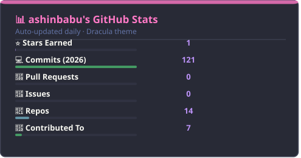

# Hi, I'm Ashin Babu 👋

  

  
  
  
  

---

## 🧑‍💻 About Me

- 🎓 **Research Scholar** at BITS Pilani — Department of Computer Science and Information Systems
- 🔬 My research interests include **multimodal AI**, **embodied intelligence**, and building AI systems that behave reliably in interactive environments
- 🛠 I enjoy working across the stack — from low-level **C++** to **Python** scripting to **ReactJS** frontends
- 📸 When I'm not coding, I'm probably behind a camera
- 📬 Reach me at **ashin33149@gmail.com** or **ashin.babu@pilani.bits-pilani.ac.in**

---

## 🛠 Skills & Technologies

**Languages:** Python · C++ · JavaScript

**Frameworks & Libraries:** ReactJS · Node.js

**Tools & Platforms:** Git · GitHub · Linux · VS Code

**Research Interests:** Multimodal AI · Embodied Intelligence · Reliable AI · Machine Learning

---

## 📊 GitHub Stats

  

  

---

## 🗂 Featured Projects

> 🚧 Projects section — highlights of my work. Check my [repositories](https://github.com/ashinbabu?tab=repositories) for everything.

| Project | Description | Stack |
|---------|-------------|-------|
| 🤖 [**SmolVLA Implementation**](https://github.com/ashinbabu/smolVLA-implementation) | SmolVLA fine-tuning and simulation experiments | Python, LeRobot, MuJoCo |
| 🎨 [**CatDiffusion**](https://github.com/ashinbabu/catDiffusion) | Educational implementation of a pixel-space diffusion model | Python, PyTorch |
| 🌐 [**Tribal Language Translator**](https://adivaani.tribal.gov.in/) | AI translator tool for Tribal Languages — Ministry of Tribal Affairs | NLP, NMT, HPC |
| 📷 [**Photography Portfolio**](https://ashinbabu.github.io/photography/) | Visual storytelling through the lens | Photography |

---

## 🎓 Education

| Degree | Institution | Period |
|--------|-------------|--------|
| 🎓 **Research Scholar** — Computer Science & Information Systems | BITS Pilani, Rajasthan | 2025 – Present |
| 🏆 **M.Tech** — Computer Science (Software Engineering) | CUSAT, Kochi, Kerala | 2022 – 2024 |
| ⚡ **B.Tech** — Electrical & Electronics Engineering | CUSAT, Kochi, Kerala | 2016 – 2020 |

---

_"Code is like humor. When you have to explain it, it's bad."_

